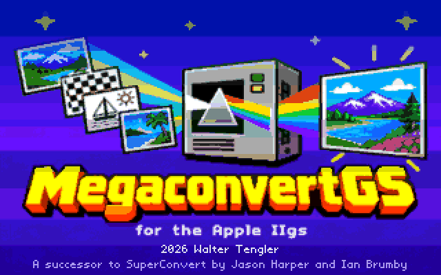
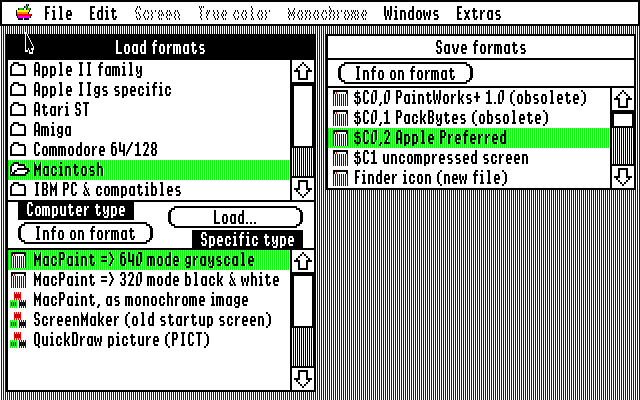
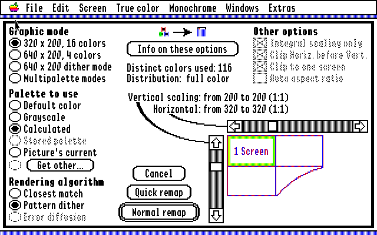
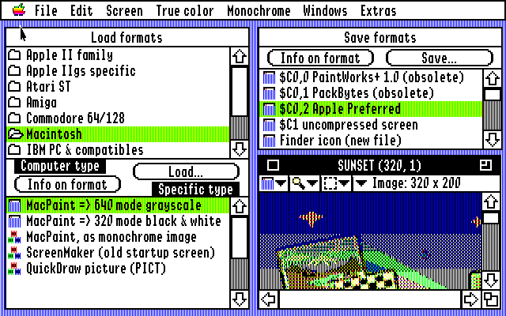

# MegaconvertGS

An image converter for the Apple IIgs, written from scratch in 65816 assembly for GS/OS.
It opens pictures from the Apple II and IIgs, the Atari ST, the Amiga, the Commodore 64,
the Macintosh, the PC, Unix machines and today's computers (PNG, JPEG, GIF, BMP, TIFF),
remaps them to Super Hi-Res in 320 or 640 mode or with a palette for every line, and
saves them in IIgs and modern formats.

MegaconvertGS is a successor to SuperConvert, the IIgs image converter by Jason Harper
and Ian Brumby, and follows its windows, menus and conversions. Where GS Remap (a modern
reimplementation of SuperConvert's conversions) has a function, MegaconvertGS gives the
same result pixel for pixel.

## Features

- **Over 50 load formats** from ten computer types, chosen in the Load formats window or
  recognised by File > Open from the file's type, size or contents.
- **Remap** true colour pictures to the screen: 320 x 200 in 16 colours, 640 x 200 in 4,
  640 dither mode, or multipalette (a palette for each line); a calculated, default,
  grey, stored or other palette; closest match, pattern dither or error diffusion; any
  size in scale steps, with Quick remap for a preview.
- **The True color menu:** histogram equalization, median, sigma, emboss, blur, sharpen,
  solarize, find edges, more or less contrast, rotate and flip, and image info with
  colour histograms.
- **Monochrome images:** error diffusion, pattern dither, threshold or halftone, and back
  to a screen or true colour picture with a choice of aspect, scaling and shrinking.
- **The image window:** the screen, true colour or monochrome image at four zooms, with
  selections, crop, pixel peek, copy to the Clipboard and full screen, half size and X4
  views.
- **Load & convert:** many files or whole folders at once, loaded one after another, and
  saved automatically if you like.
- **Save** as Apple Preferred, $C1, PackBytes, PaintWorks, Finder icons, icon resources,
  a desktop background INIT, hex data, GIF, PNG, TIFF and BMP.
- **Extras:** Oscilloscope Art, Examine file (hex, text and histogram), the System info
  report, font lists and key chart, Preferences, and help for every menu item.

## Screenshots

| | | |
|---|---|---|
|  |  |  |
| The Load formats and Save formats windows, with the Macintosh formats | The Remap dialog: mode, palette, rendering and size | A picture in the image window |

## Load formats

New in MegaconvertGS (not in SuperConvert) are marked with ★.

| Computer | Formats |
|---|---|
| Apple II | HiRes and Double HiRes (colour or black & white), Print Shop graphics, ThunderScan scans, Works of Art pages (Springboard Publisher), TDM 40 and 80 column text screens |
| Apple IIgs | Super Hi-Res ($C0 PackBytes and Apple Preferred, $C1), PaintWorks and Paintworks Gold, DreamGrafix (256 and 3200 colours), Print Shop IIgs colour graphics and library, Finder icons, AST and ComputerEyes digitizer files, "3200 color" pictures (plain, .3201 and compressed) |
| Atari ST | Degas, Degas Elite, Neochrome, Tiny, Spectrum 512 (plain and compressed) |
| Amiga | IFF ILBM (with HAM, Extra HalfBrite and 24-bit) |
| Commodore 64/128 | Doodle, Koala, Print Shop screens |
| Macintosh | MacPaint (three ways), ScreenMaker, ★ QuickDraw PICT (version 1 and 2, 1 to 32 bits) |
| PC | BMP (1 to 32 bits, Windows and OS/2), GEM/Ventura IMG, PC Paintbrush, DeluxePaint LBM, FliAway frames |
| Unix | Sun Rasterfile, SGI, PBM/PGM/PPM |
| Any computer | JPEG (baseline and ★ progressive), GIF (87a, 89a, interlaced, transparent), PNG (every kind), CompuServe RLE, IPI, QRT, ★ TIFF, ★ Truevision Targa (TGA) |

A picture larger than the screen is fitted to it; black & white pictures taller than a
screen become true colour pictures. Not there yet: New Print Shop graphics and the
Babelfish imports.

## Save formats

Apple Preferred ($C0/2), uncompressed screen ($C1), PackBytes ($C0/1), PaintWorks ($C0/0),
Finder icon (a new file, or added to one), icon resource (★ a new file, or added to one),
desktop background image INIT, hex data, GIF, PNG (with compression and comment options),
TIFF (with SuperConvert's TIFF Save Options) and ★ BMP. GIF, PNG, TIFF and BMP are written
with square pixels, as the picture looks. Not there yet: the Babelfish exports.

## Speed

MegaconvertGS has been made several times faster than its first versions without
changing a single result: every picture still matches GS Remap's. Times in MAME at the
IIgs's 2.8 MHz:

| Task | Before | Now | Faster |
|---|---:|---:|---:|
| The remap test suite (43 remaps) | 1585 s | 387 s | 4.1x |
| Remap a 640 mode screen to 320 mode | 95.5 s | 10.9 s | 8.8x |
| Remap a 320 x 200 picture to 640 mode | 54.4 s | 9.9 s | 5.5x |
| Remap a picture to multipalette | 46.5 s | 15.6 s | 3.0x |
| Open the 22 test PNGs | 463 s | 227 s | 2.0x |
| Open a 700 x 500 PNG | 177 s | 64 s | 2.8x |
| Open a 400 x 300 JPEG | 41.0 s | 25.6 s | 1.6x |
| Save as PNG | 62.0 s | 27.6 s | 2.2x |
| Save as GIF | 41.8 s | 25.6 s | 1.6x |
| Save as TIFF | 32.5 s | 17.9 s | 1.8x |
| Monochrome, error diffusion | 29.8 s | 13.8 s | 2.2x |
| Monochrome image back to a screen | 75.3 s | 19.8 s | 3.8x |
| Histogram equalization | 12.9 s | 10.6 s | 1.2x |
| More or less contrast | 7.8 s | 5.4 s | 1.4x |

How it was done: [docs/speed-plan.md](docs/speed-plan.md).

## Download and run

Download **MegaconvertGS.po** from the
[Releases](https://github.com/portwally/MegaconvertGS/releases) page: an 800K ProDOS disk
with three files:

- **MegaconvertGS:** the program (GS/OS type S16)
- **MCGS.Help:** the help text, for Help! and Menu item help
- **MCGS.Title:** the title picture shown at start-up (a click or a key skips it; without
  the file there is none)

**You need** an Apple IIgs with GS/OS (it is tested with System 6.0.4) and enough memory
for the pictures you open; it is tested in MAME with 4 MB. The disk doesn't start by
itself: boot your System 6 disk or hard disk, then open the MegaconvertGS disk in the
Finder and double-click MegaconvertGS. To keep it on a hard disk, copy the three files
into one folder. Preferences are saved in MCGS.Prefs beside them.

- **On a real IIgs:** write the image to a 3.5" disk, or use it with a FloppyEmu, BlueSCSI
  or similar device.
- **In MAME** (on a Mac, easiest through [Ample](https://github.com/ksherlock/ample)):
  choose the Apple IIgs, boot your System 6 hard disk image, and put MegaconvertGS.po in a
  3.5" drive.

To build it yourself, see [docs/BUILDING.md](docs/BUILDING.md).

## Credits

- MegaconvertGS: © 2026 Walter Tengler
- A successor to SuperConvert by Jason Harper and Ian Brumby, published with the kind
  permission of Ian Brumby. Its code is new, written from scratch.
- The Apple II character set is drawn from the Print Char 21 font by Kreative Software.
- Built with Merlin 32 and Cadius, tested in MAME (through Ample) against GS Remap.

## For developers

- [Building and testing](docs/BUILDING.md): the tools, building, running it in MAME, and
  the test suites.
- [How it works](docs/TECHNICAL.md): the source layout and segments, how each part
  matches SuperConvert and GS Remap, and the history of the milestones.
- [Speed plan](docs/speed-plan.md) and SuperConvert as read from its program file
  (`docs/superconvert-*.md`).
